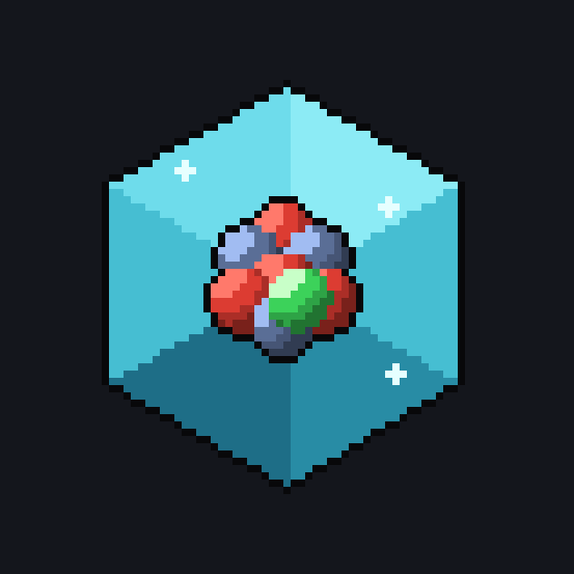
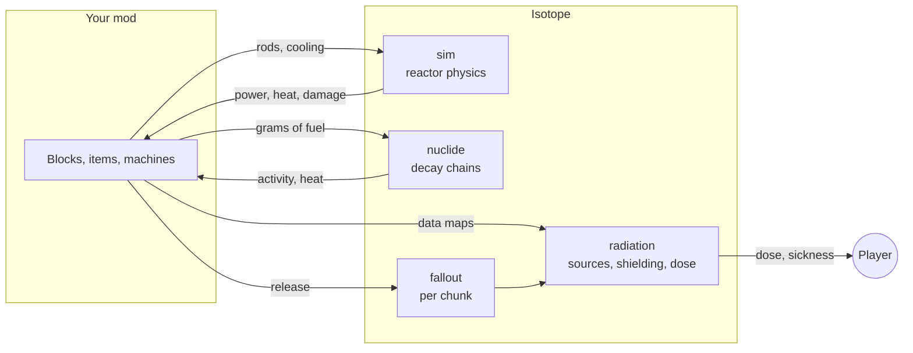
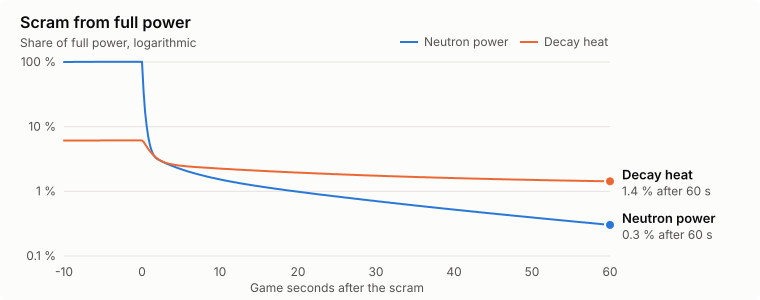
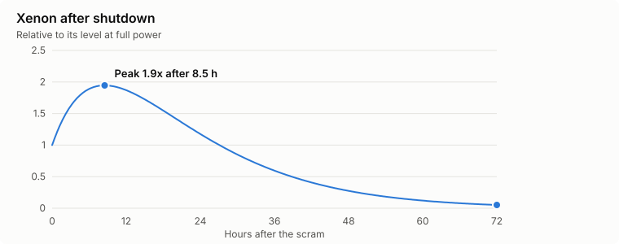

<div align="center">



# Isotope

**A nuclear and thermal physics engine for Minecraft mods.**

Reactors, decay chains, radiation and fallout. No blocks, no items, only the physics.


[](COPYING.LESSER)

[What it does](#what-it-does) ·
[For players](#for-players) ·
[Data maps](#without-code-data-maps) ·
[Java API](#with-code) ·
[Physics](#the-physics) ·
[Building](#building) ·
[Roadmap](#roadmap)

</div>

---

Isotope does the maths that nuclear mods usually write again and again: how a core heats up and is shut down, how fuel burns,
how xenon poisons it, what is left in the waste after a thousand years, and what all of that does to the player standing next
to it. Your mod adds the blocks.

It was taken out of **Create: Going Nuclear**, which uses it from version 0.612 on. It does not need Create.

> [!WARNING]
> Version 0.x is experimental. Names and numbers can change between versions until 1.0.

## What it does

| | |
|---|---|
| ⚛️ **Reactors** | Point kinetics with six delayed neutron groups, Doppler and void feedback, boron, xenon and samarium, decay heat, a two-out-of-four protection system, accidents up to a core melt |
| 🧪 **Decay** | 34 nuclides with measured half-lives and their chains. Any time step is exact, from one tick to a billion years |
| ☢️ **Radiation** | Alpha, beta and gamma from items, blocks, machines and the ground; inverse square law, shielding block by block, protective clothing |
| 🩺 **Dose** | Counted in millisieverts and saved with the player, with radiation sickness that gets worse as it rises |
| 🌬️ **Fallout** | One value per chunk. It drifts with the wind, spreads, fades and kills plants, and it does not care whether a reactor or a bomb released it |
| 🧩 **Open to other mods** | What radiates, shields and protects is data. Mods that use Isotope understand each other's materials without extra code |



## For players

Install it when a mod asks for it. On its own it changes nothing you would notice: it adds nothing to the world, and nothing
radiates until another mod or a data pack says so.

The settings are under **Mods → Isotope → Config** while you are in a world: radiation on or off, sickness, whether fallout
kills plants, dose rates and recovery.

## Using it in your mod

### Without code: data maps

Put these in your mod or in a data pack. Tags work as keys, and the last matching entry wins.

<details open>
<summary><b>What radiates</b></summary>
<br>

`data/isotope/data_maps/item/emission.json` is the radiation of one item, `data/isotope/data_maps/block/emission.json` of a
placed block.

```json
{
  "values": {
    "mymod:thorium_ingot": { "activity_bq": 1.0e6, "alpha": 0.6, "beta": 0.3, "gamma": 0.1 },
    "#mymod:hot_dusts":    { "activity_bq": 2.5e8, "alpha": 0.55, "beta": 0.3, "gamma": 0.15, "dust": true }
  }
}
```

| Field | Meaning |
|---|---|
| `activity_bq` | Decays per second |
| `alpha`, `beta`, `gamma` | How the decays share out, together at most 1 |
| `dust` | Also breathed in when carried without a respirator |

</details>

<details>
<summary><b>What shields</b></summary>
<br>

`data/isotope/data_maps/block/shielding.json`: the thickness in centimetres that halves gamma radiation. Smaller is better.

```json
{ "values": { "mymod:tungsten_block": 0.8 } }
```

| Built in | Half value layer |
|---|---:|
| Lead blocks of any mod (`#c:storage_blocks/lead`) | 1.2 cm |
| Iron, netherite, anvils | 2.5 cm |
| Concrete, obsidian | 6 cm |
| Stone, dirt, sand and other solid blocks | 12 cm |
| Glass | 14 cm |
| Water | 17 cm |
| Wood, wool | 25 cm |

A block counts as 10 cm, so one block of iron lets a sixteenth through.

</details>

<details>
<summary><b>What protects</b></summary>
<br>

`data/isotope/data_maps/item/protection.json`: the share a worn piece stops. The four pieces add up. `respirator` only counts on
the head.

```json
{ "values": { "mymod:hazmat_mask": { "alpha": 0.24, "beta": 0.2, "gamma": 0.025, "respirator": 0.5 } } }
```

</details>

### With code

**Dose and fallout**

```java
IsotopeApi.addDose(player, 50f);                    // millisieverts
IsotopeApi.releaseFallout(level, pos, 2500);        // a reactor or a bomb, all the same
double here = IsotopeApi.falloutAt(level, x, z);
```

**A reactor core**

```java
PlantSim plant = new PlantSim(PlantConfig.standard());
plant.setMode(PlantSim.Mode.DRIVEN);                // you supply cooling and pressure
plant.startAtPower(1.0);                            // 100 %
plant.setDriven(1.0, 1.0, 1.0, plant.cfg.ratedPressure);  // flow, heat sink, water level, pressure in bar
plant.manualTrip();                                 // SCRAM
for (int tick = 0; tick < 1200; tick++)             // one minute
    plant.step(0.05);
PlantSnapshot s = plant.snapshot();                 // power, temperatures, xenon, damage and more
```

**Nuclear material**

```java
NuclideInventory fuel = new NuclideInventory()
        .addGrams(Nuclides.CS137, 2)
        .addGrams(Nuclides.SR90, 1)
        .addGrams(Nuclides.PU241, 5);
fuel.decay(30 * YEAR);                              // one step, exact
double watts = fuel.heatWatts();
double americium = fuel.grams(Nuclides.AM241);      // grew in from the plutonium

Nuclides.register(new Nuclide("Th-232", 232, 1.405e10 * YEAR, Nuclide.Mode.ALPHA, 4.08, 0.002, null));
```

`YEAR` is `365.25 * 86400`. The reactor and material examples are compiled and run by
[`ReadmeExamplesTest`](src/test/java/dev/isotopelib/ReadmeExamplesTest.java).

**Sources that change**

| You have | Use |
|---|---|
| A block entity, such as a tank of waste | implement `RadiationSource` |
| An item whose stacks differ | implement `RadioactiveItem` |
| A block that depends on its state | implement `RadioactiveBlock` |
| Something else, such as a running reactor | `IsotopeApi.registerField(...)` |
| Armor with conditions, or another mod's radiation | listen to `ExposureEvent` (once a second per player) |

**The dependency**, in `neoforge.mods.toml`:

```toml
[[dependencies.mymod]]
    modId="isotope"
    type="required"
    versionRange="[0.1.0,0.2.0)"
    ordering="AFTER"
    side="BOTH"
```

There is no public Maven yet. Until then, run `gradlew publish` here and point your build at the `repo` folder it creates:

```groovy
repositories { maven { url = file('../isotope/repo') } }
dependencies { implementation('dev.isotopelib:isotope:0.1.0') { transitive = false } }
```

### Where things are

| Package | Contents | Needs Minecraft |
|---|---|:---:|
| `dev.isotopelib.api` | What other mods call and implement | yes |
| `dev.isotopelib.sim` | Reactor physics | no |
| `dev.isotopelib.nuclide` | Nuclides, chains, inventories | no |
| `dev.isotopelib.fallout` | Fallout (`FalloutField` is plain Java) | partly |
| `dev.isotopelib.radiation` | Sources, shielding, dose, sickness (`RadiationMath` is plain Java) | partly |

## The physics

Both charts come straight from the engine. One game second counts as one real minute for the slow processes (xenon, decay heat);
the neutrons run in real time.

<picture>
  <source media="(prefers-color-scheme: dark)" srcset="docs/scram-dark.svg">
  
</picture>

<picture>
  <source media="(prefers-color-scheme: dark)" srcset="docs/xenon-dark.svg">
  
</picture>

Some of the values the tests hold it to:

| Quantity | Reference | Tolerance |
|---|---:|---:|
| Specific activity of U-238 | 12.4 kBq/g | 1 % |
| Specific activity of Pu-239 | 2.30 GBq/g | 1 % |
| Specific activity of Cs-137 | 3.21 TBq/g | 1 % |
| Decay heat of Pu-238 | 0.57 W/g | 3 % |
| Decay heat of Am-241 | 0.114 W/g | 3 % |
| Am-241 from Pu-241, peak after | 73 years | 5 years |

Where it simplifies: decay energies are rounded to about ten percent, the core is one-dimensional along its height, and dose
rates are scaled up (`doseTimeScale`) because real ones are too small to notice in a play session.

## Worlds from Create: Going Nuclear before 0.612

Doses and fallout carry over. `goingnuclear:dose_msv` is read as `isotope:dose_msv`, and `goingnuclear_fallout` is read when there
is no `isotope_fallout` yet. Both are saved under the new names from then on; the old fallout file stays as it is. Going Nuclear
versions before 0.612 cannot run together with Isotope.

## Building

You need JDK 21.

```
gradlew build        # compile, run all tests, jar in build/libs
gradlew test         # only the tests
gradlew publish      # put the jar into repo/ for other projects on this machine
```

## Roadmap

- [x] Reactor physics, decay chains, radiation, dose and fallout
- [x] Data maps for emission, shielding and protection
- [x] Create: Going Nuclear runs on it
- [ ] A public Maven
- [ ] Waste in Going Nuclear based on real nuclides
- [ ] Stable API, version 1.0

## Contributing

Bug reports and pull requests are welcome. Three rules:

1. `sim`, `nuclide`, `FalloutField` and `RadiationMath` stay free of Minecraft classes, so they can be tested on their own.
2. New physics comes with a test against a known value, with its source.
3. No content. Blocks and items belong in the mods that use Isotope.

## License

[GNU LGPL 3.0](COPYING.LESSER), on top of the [GPL 3.0](COPYING). Any mod may use and bundle Isotope, whatever its own license.
Changes to Isotope itself have to be published under the same license. The content of Create: Going Nuclear is not covered by it.
